# GDrive

A desktop client for Google Drive on Windows, macOS and Linux. Browse your Drive, preview files without leaving the app, manage and upload files, and keep chosen files, folders or the whole Drive in two-way sync with a folder on your computer.

Package id: `zm.co.www.gdrive`.

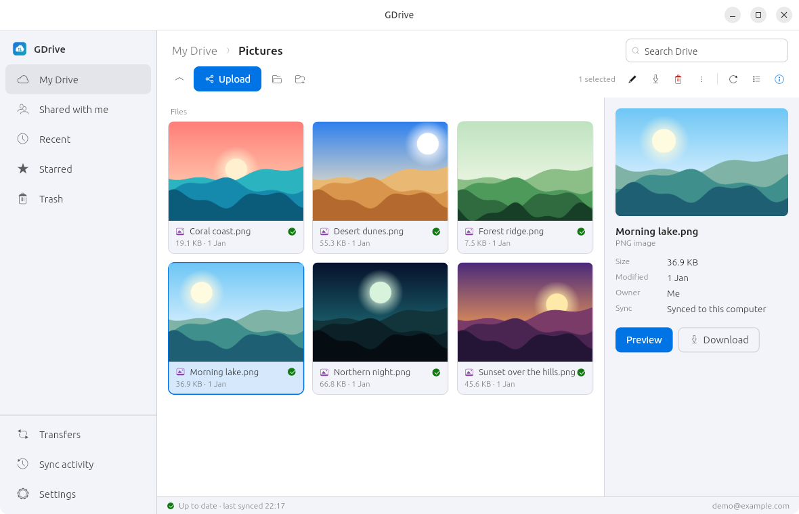

- [Screenshots](#screenshots)
- [What it can do](#what-it-can-do)
- [Running it](#running-it)
  - [1. Install the prerequisites](#1-install-the-prerequisites)
  - [2. Get your `oauth.json`](#2-get-your-oauthjson)
  - [3. Run](#3-run)
  - [Sign-in problems](#sign-in-problems)
  - [Demo mode (no Google account)](#demo-mode-no-google-account)
  - [Building a release](#building-a-release)
- [How sync behaves](#how-sync-behaves)
- [Keyboard shortcuts](#keyboard-shortcuts)
- [Where your data lives](#where-your-data-lives)
- [For developers](#for-developers)
- [Not built yet](#not-built-yet)

## Screenshots

All taken from the demo build on Linux, so the files shown are sample data.

| | |
|---|---|
| **List view** with the details panel<br>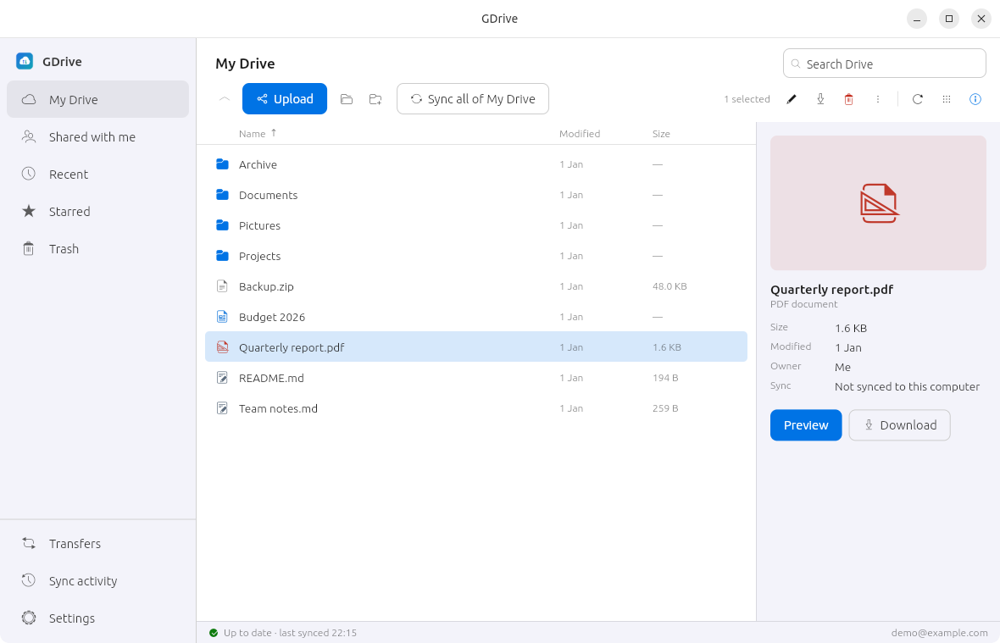 | **Dark theme**<br>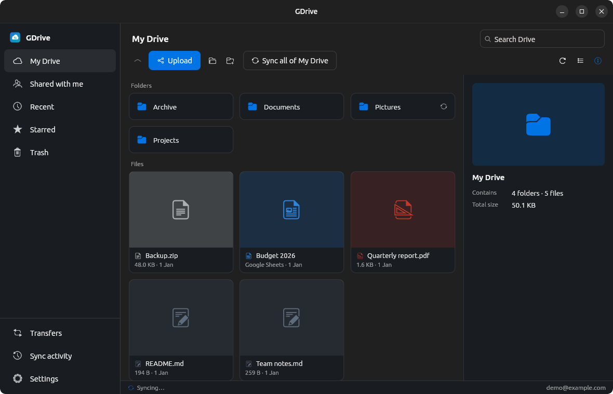 |
| **PDF viewer**<br>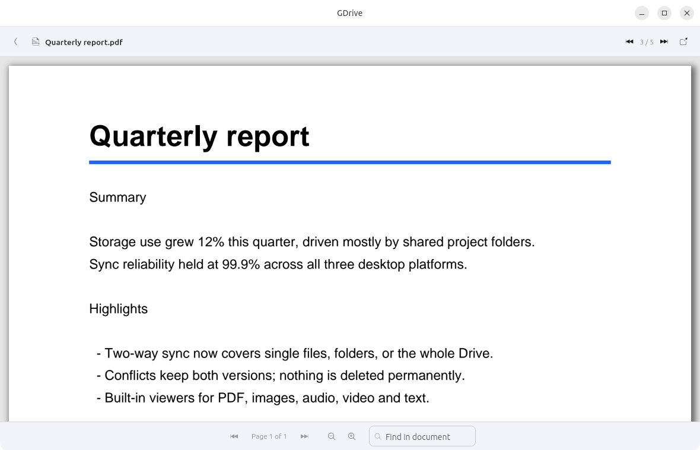 | **Image viewer**<br>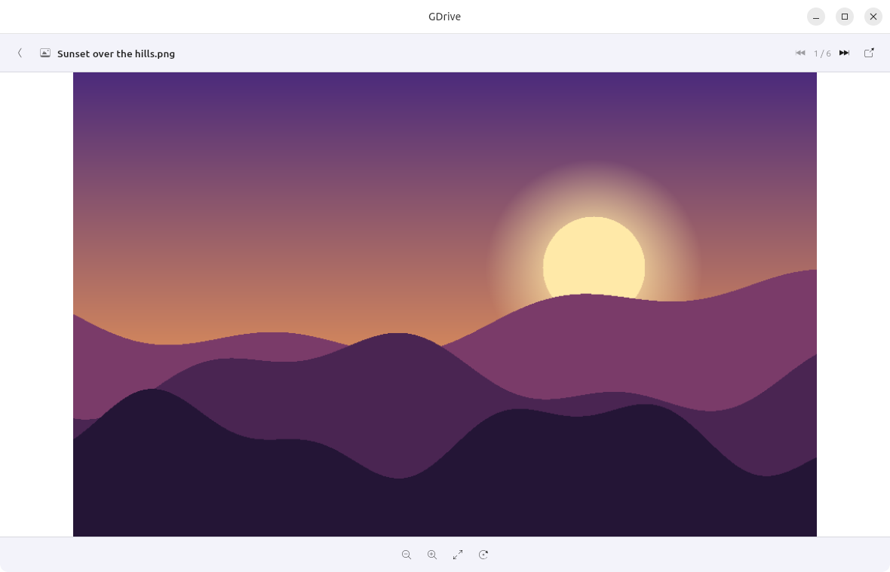 |
| **Text and code editor**<br>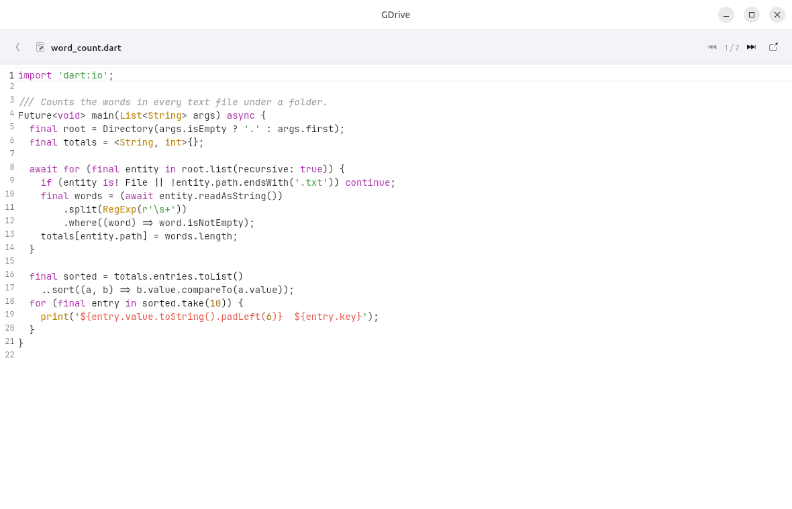 | **Sync activity**<br>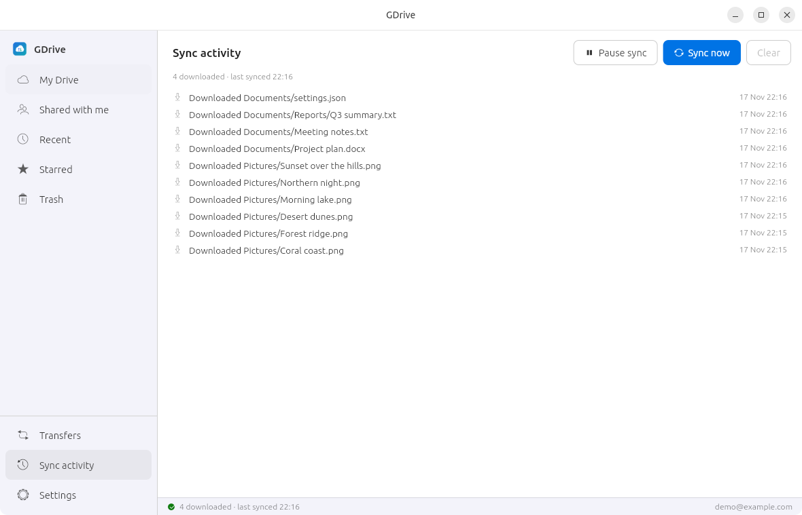 |
| **Transfers**<br>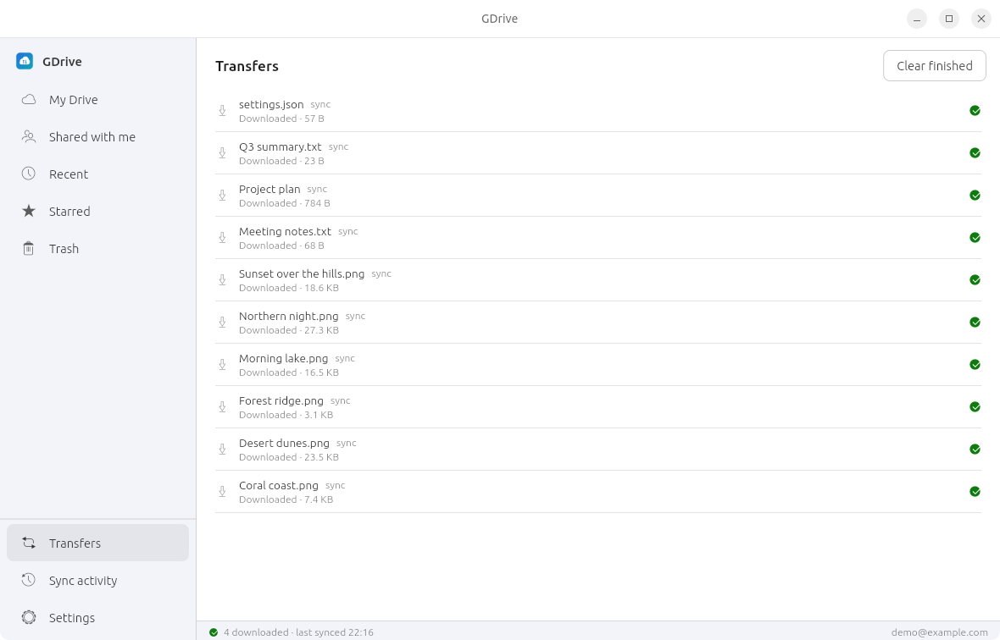 | **Settings**<br>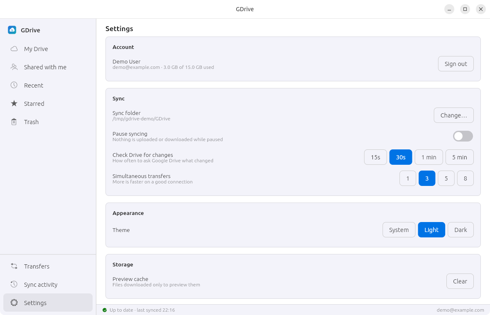 |
| **Sign-in**<br>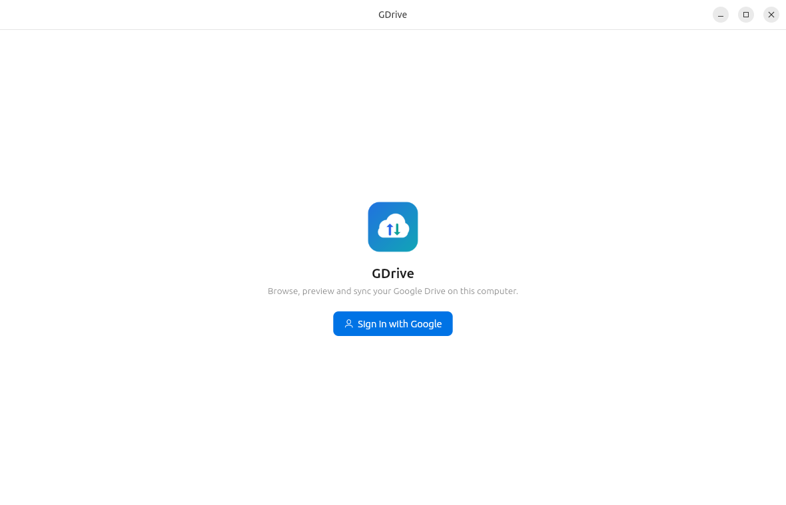 | **Windows look** (Fluent), rendered on Linux<br>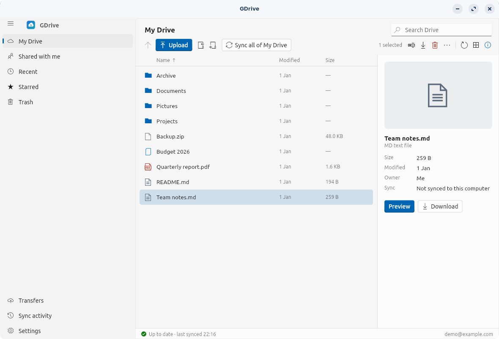 |

The Windows look above is the Fluent shell running on Linux, so the title bar is Linux's; there is no macOS screenshot because that shell depends on native macOS window effects.

## What it can do

### Browse

- **Sections**: My Drive, Shared with me, Recent, Starred and Trash, plus search by name.
- **Two views**: a sortable list (name, modified, size) and a thumbnail view that groups folders and files and shows a picture for each file — Drive's own thumbnail, or the synced image itself.
- **Details panel**: describes the selected file (large preview, type, size, modified date, owner, sync state), the total for a multi-selection, or the current folder when nothing is selected. Toggle it with the ⓘ button.
- **Works offline for browsing**: listings are cached locally and refreshed from Drive in the background.

### Manage files

- Upload files or whole folders, from a picker or by dragging them onto the window.
- Download files or folders to anywhere on disk.
- New folder, rename, move, make a copy, star, move to Trash, restore, delete forever, empty Trash.
- Open in the browser, or open with your computer's default app.
- Everything is available from the toolbar, the right-click menu and the keyboard.

### Preview and edit

Double-click a file (or press Space) to open it in the built-in viewer, with previous/next through the folder.

| Type | Viewer |
|---|---|
| PDF | Page navigation, zoom, find in document |
| Images | Zoom, pan, rotate, fit to window |
| Audio and video | Play/pause, seek, volume, speed, full screen; streams from Drive, or plays the synced copy |
| Text and code | Syntax highlighting, line numbers, find; **editable**, and Save uploads a new revision |
| Google Docs, Sheets, Slides | Shown as PDF |
| Anything else | File details, with "Open in browser" and "Open with default app" |

Text files over 5 MB and files in Trash open read-only.

### Sync

- Sync a single file, a folder, or all of My Drive to a local folder, in both directions.
- Runs in the background: polls Drive for changes and watches the local folder.
- Keeps both versions on conflict and never deletes anything permanently. See [How sync behaves](#how-sync-behaves).
- A Transfers page shows every upload and download with progress; a Sync activity page logs what sync did and lets you pause, resume or sync now.

### Fits the platform

- Uses `fluent_ui` on Windows, `macos_ui` on macOS (with a native menu bar) and `yaru` on Linux.
- Light and dark themes, following the system or set in Settings.
- Remembers window size and position; only one copy of the app runs at a time.
- Sign-in tokens are kept in the OS keychain, never in a file.

## Running it

### 1. Install the prerequisites

- **Flutter** 3.41 or newer, with desktop support for your platform (`flutter doctor` should show it ready).
- **Linux**:

  ```sh
  sudo apt install clang cmake ninja-build pkg-config libgtk-3-dev libsecret-1-dev libmpv-dev
  ```

  A keyring service (GNOME Keyring or KWallet) must be running so tokens can be stored; desktop sessions normally have one.
- **Windows**: Visual Studio with the "Desktop development with C++" workload.
- **macOS**: Xcode.

Then fetch packages:

```sh
flutter pub get
```

> Only the Linux build has been compiled and run so far. The Windows and macOS projects are in place but untested.

### 2. Get your `oauth.json`

The app signs in to Google with an OAuth client that you create once in Google Cloud. It is free.

1. **Create a project.** Open [console.cloud.google.com](https://console.cloud.google.com/), click the project picker at the top, choose **New Project**, name it (for example "GDrive") and create it. Make sure it is selected.

2. **Enable the Drive API.** Go to **APIs & Services → Library**, search for **Google Drive API**, open it and click **Enable**.

3. **Set up the consent screen.** Go to **APIs & Services → OAuth consent screen** (Google may call this "Google Auth Platform").
   - Enter an app name and your email for the support and developer contacts.
   - Audience: **External**. (Choose **Internal** only if you are in a Google Workspace organisation and want to limit it to that organisation.)
   - Under **Audience → Test users**, add every Google account that will sign in. While the app is in "Testing", accounts not on this list are blocked.

4. **Create the client.** Go to **APIs & Services → Credentials → Create credentials → OAuth client ID**.
   - Application type: **Desktop app**. This matters — a "Web application" client will not work.
   - Give it any name and click **Create**.
   - Copy the **Client ID** and **Client secret** from the dialog straight away, or download the JSON. Google may not show the secret again later; if you lose it, add a new secret from the client's page.

5. **Create the file.** In the project folder:

   ```sh
   cp config/oauth.example.json config/oauth.json
   ```

   Open `config/oauth.json` and paste in your values:

   ```json
   {
     "GOOGLE_CLIENT_ID": "1234567890-abc123.apps.googleusercontent.com",
     "GOOGLE_CLIENT_SECRET": "GOCSPX-..."
   }
   ```

   `config/oauth.json` is git-ignored, so it is never committed. Keep it out of anything you share.

### 3. Run

```sh
flutter run -d linux --dart-define-from-file=config/oauth.json
```

Use `-d windows` or `-d macos` on those platforms.

Click **Sign in with Google**. Your browser opens; Google warns that the app is not verified, which is expected for your own client — choose **Advanced → Go to GDrive (unsafe)** and allow access to Drive. Return to the app and your files appear.

The client ID and secret are compiled in, so after editing `oauth.json` stop the app and run it again; a hot reload is not enough.

If you run without `--dart-define-from-file`, the app opens on a page that repeats these setup steps.

### Sign-in problems

| What you see | Cause and fix |
|---|---|
| `Error 400: redirect_uri_mismatch` | The client was created as "Web application". Create a new one of type **Desktop app** and put its ID and secret in `oauth.json`. The type cannot be changed afterwards. |
| `Error 403: access_denied` | The account is not a test user. Add it under **OAuth consent screen → Audience → Test users**. |
| "Google sign-in is not set up yet" | The app was started without `--dart-define-from-file=config/oauth.json`, or the file still has the `YOUR_...` placeholders. |
| Asked to sign in again every week | Google expires sign-ins after 7 days while the consent screen is in "Testing". Click **Publish app** on the consent screen to stop this; for personal use you can stay unverified and keep clicking through the warning. |
| "Your session expired. Sign in again." | Access was revoked or expired. Sign in again; your synced files are untouched. |

### Demo mode (no Google account)

```sh
flutter run -d linux --dart-define=DEMO=true
```

Runs against an in-memory Drive with sample folders, pictures and documents. Its database and sync folder live in a `gdrive-demo` folder under the system temp directory. Nothing touches a real account, and everything resets each time it starts.

To see another platform's look on your machine, add `UI_KIT`:

```sh
flutter run -d linux --dart-define=DEMO=true --dart-define=UI_KIT=fluent   # or macos, yaru
```

### Building a release

```sh
flutter build linux --release --dart-define-from-file=config/oauth.json
```

The app is written to `build/linux/x64/release/bundle/`; run `gdrive` from there. Use `flutter build windows` or `flutter build macos` on those platforms.

For a Linux launcher entry, install `linux/zm.co.www.gdrive.desktop` and copy `assets/logo.png` into your icon theme as `zm.co.www.gdrive.png`.

## How sync behaves

Choose **Sync to this computer** on a file or folder (right-click), or **Sync all of My Drive** in the toolbar. Synced items mirror Drive's folder structure under the sync folder, `~/GDrive` by default; change it in Settings.

| Situation | Result |
|---|---|
| Changed on Drive | Downloaded |
| Changed locally | Uploaded as a new revision of the same file |
| New local file in a synced folder | Uploaded |
| Renamed or moved on either side | Renamed or moved on the other, without re-transferring |
| Changed on both sides | Drive's version keeps the name; yours is kept as `name (conflicted copy YYYY-MM-DD).ext` and uploaded |
| Deleted locally | Moved to Drive's trash (never permanently deleted) |
| Deleted on Drive | Local copy moved to the app's recycle folder for 30 days |
| Deleted on one side, edited on the other | The edited copy wins and is restored |
| More than 25 deletions, or 5+ that exceed a quarter of synced files | Sync stops and asks first |
| Sync folder missing (e.g. unmounted drive) | Sync refuses to run rather than treat it as "everything deleted" |
| Stop syncing an item | Files stay on both sides |

- **Google Docs, Sheets and Slides** are exported as `.docx`, `.xlsx` and `.pptx` (Drawings as PDF). Exports are download-only: local edits to them are flagged and left in place, not uploaded.
- **Shared items** you choose to sync appear under a `Shared with me` folder.
- **Names** that are not legal on disk are adjusted locally, and Drive files that share a name are numbered.
- **Temporary files** (`.part`, `.tmp`, `~$…`, `.DS_Store`, `Thumbs.db` and similar) are never uploaded.
- **Downloads** are written to a `.part` file, checksum-verified, then renamed into place. Network and rate-limit errors are retried.
- In Settings you can pause sync, change how often Drive is checked (15 s to 5 min) and how many transfers run at once.

## Keyboard shortcuts

Use Cmd instead of Ctrl on macOS.

| Keys | In the file browser |
|---|---|
| Ctrl+F | Search |
| Ctrl+U | Upload files |
| Ctrl+A | Select all |
| Click, Ctrl+click, Shift+click | Select one, toggle, select a range |
| Enter or Space | Open the folder or preview the file |
| F2 | Rename |
| Delete | Move to Trash (delete forever when in Trash) |
| Backspace | Up one folder |
| F5 | Refresh |
| Esc | Clear the selection |

| Keys | In the viewer |
|---|---|
| ← / → | Previous / next file |
| Ctrl+S | Save text edits |
| Esc | Back to files |

## Where your data lives

| What | Where |
|---|---|
| Synced files | The sync folder (`~/GDrive` unless changed) |
| Sign-in tokens | OS keychain: Keychain (macOS), Credential Manager (Windows), Secret Service (Linux) |
| Cached file list, sync records, settings, activity log | `gdrive.sqlite` in the app's data folder (Linux: `~/.local/share/zm.co.www.gdrive/`) |
| Files removed by sync | `recycle/` in the same folder, kept 30 days |
| Preview downloads | The app's cache folder; clear it from Settings |

**Sign out** (Settings) revokes the app's access and clears the tokens and the database. Files already in the sync folder stay where they are.

## For developers

### Layout

```
lib/
  main.dart            start-up wiring
  app.dart             root widget: picks the UI kit, gates on sign-in
  shell/               sidebar shells for each kit, destinations, status bar
  core/
    db/                drift (SQLite) database
    secure/            OS keychain wrapper
    platform/          UI kit detection, window, pickers
    ui/                logo, notices, and adaptive/ controls that follow the kit
    util/              names, formatting, hashing, retry
  features/
    auth/              OAuth sign-in, session, token storage
    drive/             Drive API boundary, repository, browser, thumbnails, details panel
    sync/              reconciler, remote tree, local scanner, engine, scheduler
    transfers/         upload/download queue
    preview/           viewer routing and the built-in viewers
    settings/
  dev/                 in-memory Drive and sign-in for demo mode and tests
tool/                  logo generator, coverage summary, screenshot script
docs/screenshots/      images used in this README
```

- **State**: Riverpod notifiers; no global singletons.
- **Storage**: SQLite through drift; tokens through `flutter_secure_storage`.
- **Boundaries**: Drive (`DriveApi`), Google sign-in (`AuthGateway`), the keychain (`SecureStore`), the clock, file pickers, the folder watcher and the viewers are interfaces supplied through providers, so each has a fake.

### Tests

```sh
flutter test --coverage
python3 tool/coverage_summary.py   # per-file summary, lowest first
```

The suite drives the real sync engine against the in-memory Drive and a temp folder, and runs the widget tests under all three UI kits.

Excluded from line coverage, each marked in source with the reason: `main.dart` (process start-up), `core/platform/system.dart` (file-picker and URL-launcher plugin calls), `features/preview/native_viewers.dart` (PDFium and libmpv wrappers), native window setup in `core/platform/window.dart`, and drift table declarations.

### Common tasks

After changing a table in `core/db/database.dart`:

```sh
dart run build_runner build
```

After changing the logo design in `tool/make_logo.py` (writes `assets/`, the macOS icon set and the Windows `.ico`):

```sh
python3 tool/make_logo.py
```

To retake the README screenshots (Linux, with an unlocked desktop, `xwininfo` and ImageMagick):

```sh
tool/screenshots.sh              # all of them
tool/screenshots.sh browse dark  # only the named ones
```

The script starts the demo build once per shot with a scene in `GDRIVE_DEMO_SCENE`, which tells the demo what to open; `GDRIVE_UI_KIT` picks the shell. The scene options are documented in `lib/dev/demo_director.dart`.

`fluent_ui` is pinned to 4.15.1 because later versions need a newer Flutter than 3.41; raise the pin when upgrading Flutter.

## Not built yet

- System tray / close-to-tray (needs `libayatana-appindicator3-dev` on Linux).
- Resuming an interrupted upload after the app restarts; it starts over.
- Multiple accounts.
- A menu bar on Windows and Linux; the toolbar, right-click menu and shortcuts cover the same actions.
